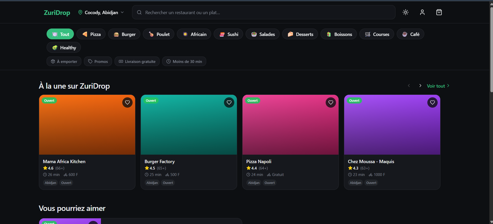
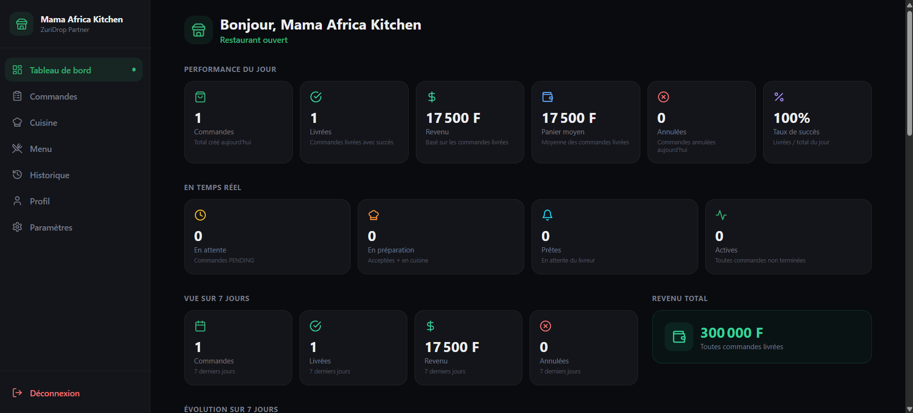
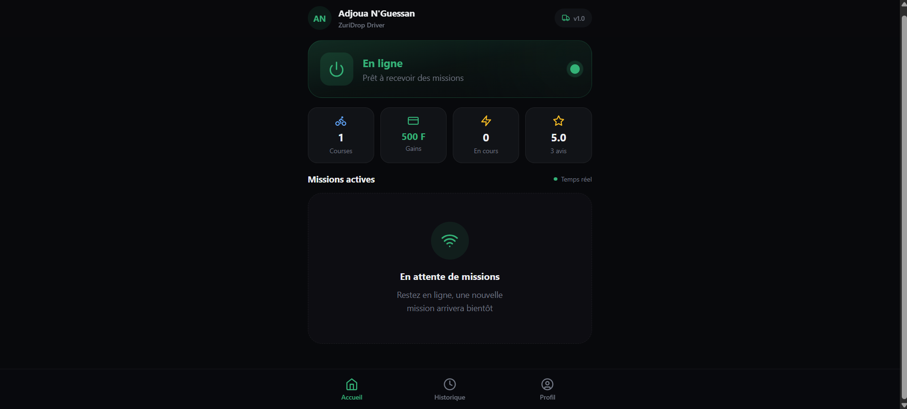
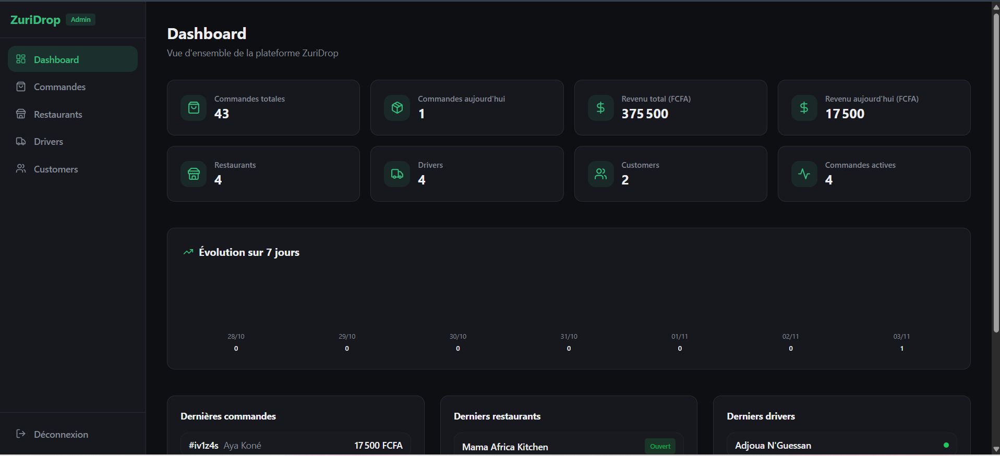
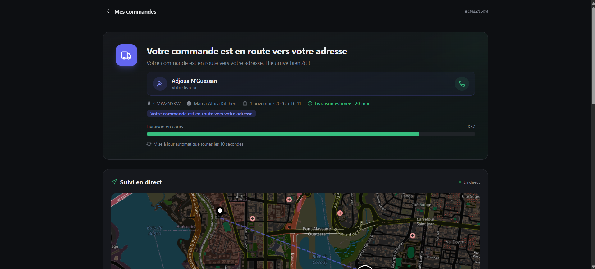
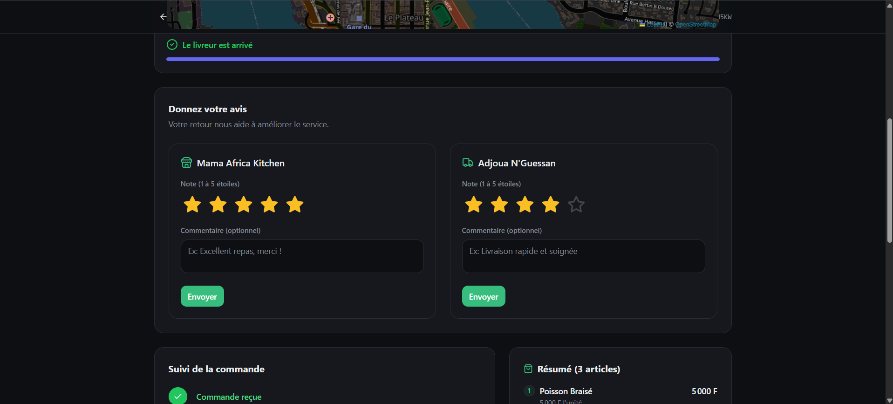

# ZuriDrop

### Full-Stack Food Delivery Platform

**ZuriDrop** is a multi-application food delivery platform built with a TypeScript monorepo architecture. It connects customers, restaurant merchants, delivery drivers, and platform administrators through dedicated applications powered by a centralized backend.

The project demonstrates the architecture and development of a multi-role delivery ecosystem, including restaurant management, order processing, driver dispatch, delivery tracking, promotions, and customer reviews.

## 🎬 Video Demonstration

Watch ZuriDrop in action — a complete food delivery
workflow across the customer, merchant, driver,
and admin interfaces.

**[▶ Watch the Full-Stack Demo](https://github.com/chris9824/zuridrop/releases/tag/v1.0.0-demo)**

The demo covers restaurant browsing, order placement,
merchant processing, driver delivery, live tracking,
admin analytics, and customer reviews.

## Key Features

### Customer Application
- Browse restaurants and explore available menus.
- Manage customer accounts and delivery addresses.
- Place orders and view order history.
- Track order progress and deliveries.
- Apply promotional codes during checkout.
- Rate restaurants and delivery drivers after completed orders.

### Merchant Dashboard
- Manage restaurant information and settings.
- Create and update menu items.
- Receive and process incoming orders.
- Manage kitchen preparation workflows.
- View order history and restaurant operations.
- Update restaurant availability and preparation settings.

### Driver Dashboard
- Access delivery assignments.
- View delivery details and active missions.
- Manage pickup and delivery workflows.
- Confirm completed deliveries.
- Review delivery history and earnings.
- Manage driver profile information.

### Administration Dashboard
- Monitor platform activity through a centralized dashboard.
- View customers, restaurants, drivers, and orders.
- Track order statistics and platform revenue.
- Access administrative management interfaces.

## Technology Stack

| Layer | Technologies |
|---|---|
| Backend | NestJS, Node.js, TypeScript |
| Frontend | Next.js 14, React, TypeScript |
| Database | PostgreSQL 16, Prisma ORM |
| Caching and Infrastructure | Redis 7, Docker |
| Mobile Application | Expo, React Native |
| Monorepo | pnpm Workspaces |
| API Documentation | Swagger / OpenAPI |
| Code Quality | ESLint, Prettier, TypeScript |

## Architecture

```text
zuridrop/
├── apps/
│   ├── api/              # NestJS REST API
│   ├── customer-web/     # Customer application
│   ├── merchant-web/     # Merchant dashboard
│   ├── driver-web/       # Driver application
│   ├── admin-web/        # Administration dashboard
│   └── mobile/           # Expo React Native application
├── packages/
│   ├── shared/           # Shared types and utilities
│   └── ui/               # Shared UI components
├── docs/
│   └── screenshots/      # Application screenshots
├── docker-compose.yml
└── pnpm-workspace.yaml
```

The NestJS backend centralizes business logic, authentication, data persistence, and order management.

Each frontend application provides a dedicated experience for its corresponding user role.

## Screenshots

Explore ZuriDrop through its four dedicated web applications and its end-to-end delivery workflow.

### 1. Customer Experience

Browse restaurants, explore menus, and place orders through the customer application.



### 2. Merchant Dashboard

Manage incoming orders, preparation workflows, and restaurant operations.



### 3. Driver Dashboard

Handle delivery assignments, manage active missions, and monitor earnings.



### 4. Administration Dashboard

Monitor platform activity, restaurants, drivers, orders, and revenue.



### 5. Order Tracking

Follow an order through its delivery journey using map-based tracking.



### 6. Customer Reviews

Customers can evaluate restaurants and delivery drivers after completing an order.



## End-to-End Order Workflow

ZuriDrop supports a complete order lifecycle connecting customers, restaurants, and delivery drivers.

1. **Order Placement:** A customer selects a restaurant, adds items to their cart, and places an order.
2. **Merchant Confirmation:** The restaurant receives and accepts the order.
3. **Order Preparation:** The merchant prepares the food and marks it ready for pickup.
4. **Driver Assignment:** An available driver receives the delivery assignment.
5. **Pickup:** The driver collects the prepared order from the restaurant.
6. **Delivery Tracking:** The customer follows the delivery progress.
7. **Delivery Confirmation:** The driver confirms that the order has been delivered.
8. **Customer Feedback:** The customer can rate the restaurant and delivery driver.

This workflow has been successfully tested locally across the customer, merchant, driver, and administration applications.

## Local Development

### Requirements

- Node.js 20+
- pnpm 9+
- Docker 24+
- Docker Compose 2+

### Clone the Repository

```bash
git clone https://github.com/chris9824/zuridrop.git
cd zuridrop
pnpm install
```

### Configure Environment Variables

Use the provided `.env.example` files as configuration templates.

Configure the required environment variables for:

- PostgreSQL database connection.
- Redis connection.
- API endpoints.
- Authentication settings.
- Application-specific services.

Do not commit credentials, API keys, or production secrets.

### Start Infrastructure

```bash
pnpm docker:up
```

### Prepare the Database

Generate the Prisma client:

```bash
pnpm db:generate
```

For a fresh development database, initialize the schema using the project's Prisma configuration.

**Important:** Review database migration or synchronization commands before running them. Back up existing databases to prevent accidental data loss.

### Run the Applications

Start each application in a separate terminal:

```bash
# Backend API
pnpm --filter @zuridrop/api dev

# Customer Application
pnpm --filter @zuridrop/customer-web dev

# Merchant Dashboard
pnpm --filter @zuridrop/merchant-web dev

# Driver Dashboard
pnpm --filter @zuridrop/driver-web dev

# Administration Dashboard
pnpm --filter @zuridrop/admin-web dev
```

### Local URLs

| Service | URL |
|---|---|
| Backend API | http://localhost:3001 |
| API Documentation | http://localhost:3001/api/docs |
| Customer Application | http://localhost:3004 |
| Merchant Dashboard | http://localhost:3002 |
| Driver Dashboard | http://localhost:3005 |
| Administration Dashboard | http://localhost:3003 |

## Build Verification

The NestJS backend and all four Next.js web applications have successfully completed individual production builds during local development.

```bash
pnpm --filter @zuridrop/api build
pnpm --filter @zuridrop/customer-web build
pnpm --filter @zuridrop/merchant-web build
pnpm --filter @zuridrop/driver-web build
pnpm --filter @zuridrop/admin-web build
```

The Expo mobile application has not yet undergone the same build verification.

Successful builds do not replace comprehensive automated testing or production deployment validation.

## Functional Testing

The following functionality has been verified during local development:

- Customer order creation.
- Merchant order acceptance and preparation.
- Driver pickup and delivery confirmation.
- Customer delivery tracking.
- Completed order status updates.
- Administration dashboard statistics updates.
- Customer review submission and retrieval through the API.

A complete delivery scenario was successfully executed across the platform's four web applications.

## Engineering Focus

ZuriDrop demonstrates practical experience with:

- Full-stack TypeScript development.
- Modular backend architecture with NestJS.
- REST API design and integration.
- Multi-role authentication and authorization.
- Relational database modeling with Prisma.
- PostgreSQL and Redis integration.
- Multi-application frontend development.
- Order lifecycle and delivery workflow management.
- Monorepo architecture using pnpm.
- Containerized development environments.
- API documentation using Swagger.
- Functional testing and debugging.

## Project Status

**Active Development — Portfolio Project**

The backend and four web applications have passed local production build checks.

Core delivery workflows have been tested successfully in a local development environment.

Current development priorities include:

- Improving the user experience and interface consistency.
- Expanding automated test coverage.
- Preparing production deployment.
- Validating mobile application functionality.
- Improving performance, reliability, and security.

ZuriDrop is a portfolio project and is not currently presented as a production-deployed commercial service.

## Repository

**GitHub:** https://github.com/chris9824/zuridrop

## License

All rights reserved. No open-source license is currently specified.
